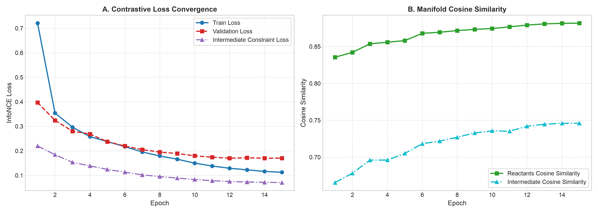
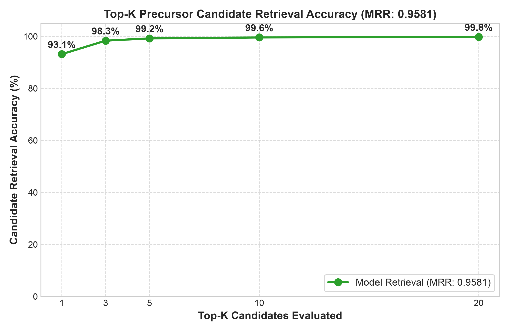
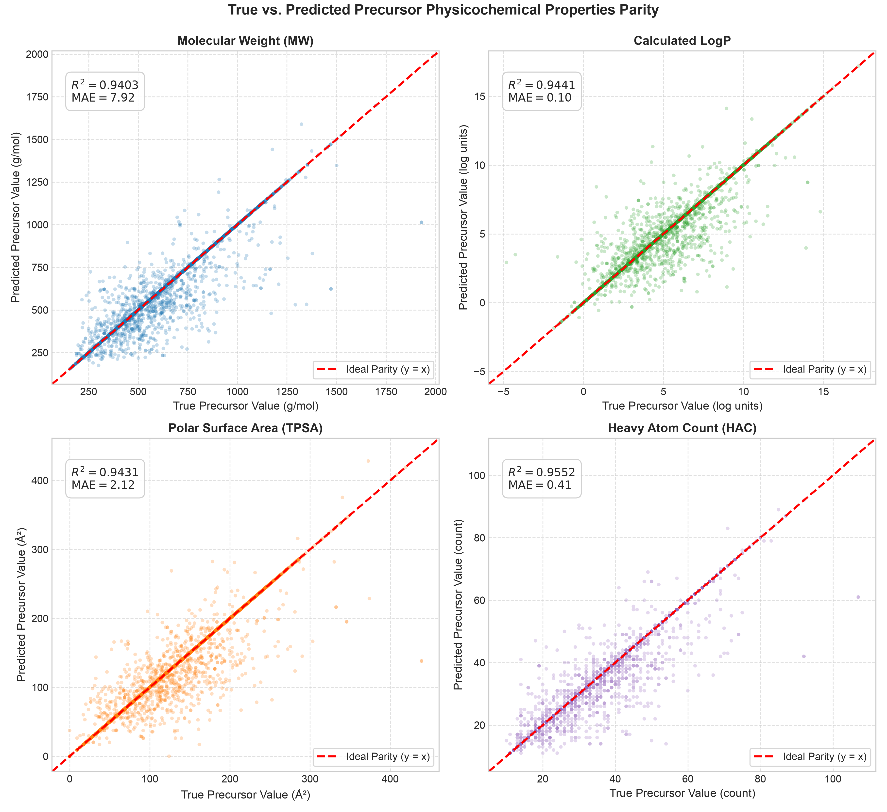
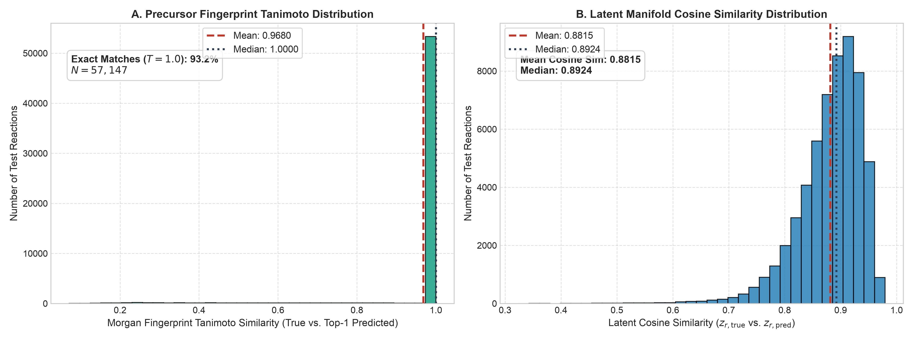
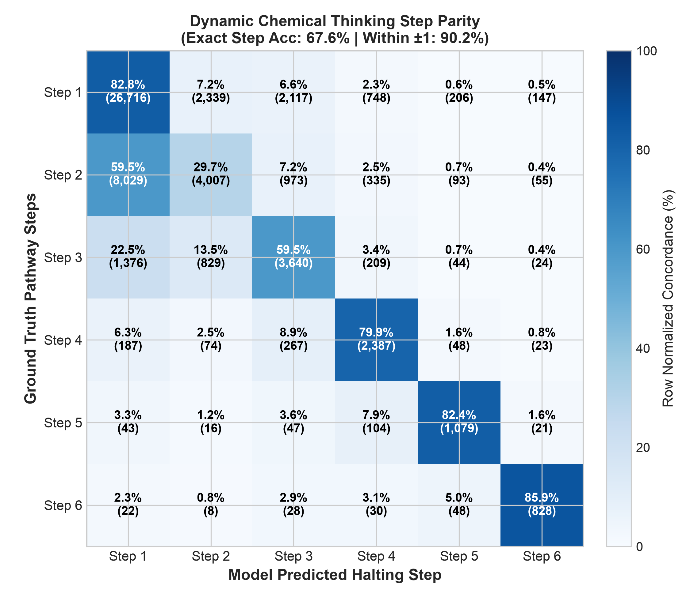
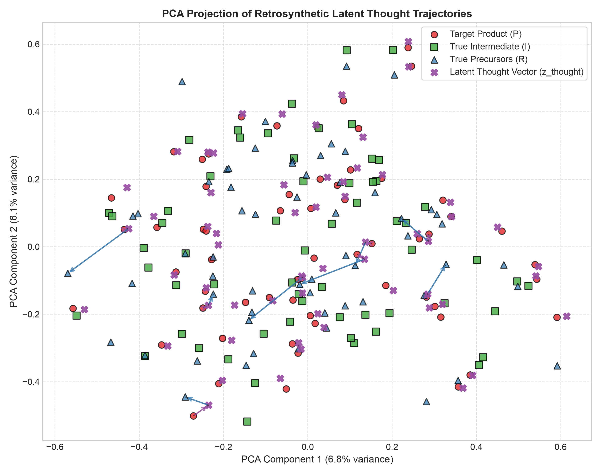
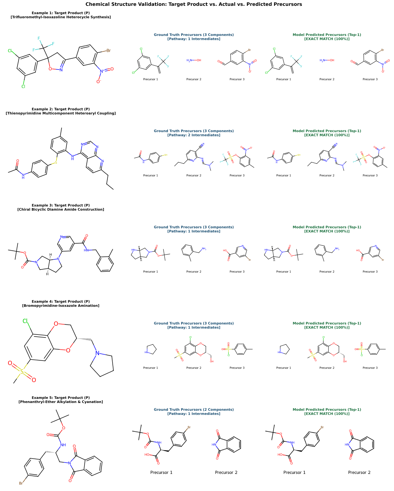

# Latent-Space Retrosynthesis with Dynamic Pathway Unrolling

This model implements a **Dynamic Mechanism-Aware Retrosynthesis Engine** that operates in a continuous latent space. 

## Model Overview

The architecture is designed for high-performance chemical reasoning. It utilizes a hybrid vector representation of molecules to achieve zero-truncation and rapid inference.

This architecture is a **Mechanism-Aware Retrosynthesis Engine** that fundamentally diverges from traditional sequence-to-sequence (Seq2Seq) or Large Language Model (LLM) approaches. Instead of generating SMILES strings token-by-token, it operates in a **continuous latent chemical manifold**.

### 1. Input Representation: The "Zero-Truncation" Vector
Traditional models struggle with long SMILES strings. This model bypasses text entirely by using a **hybrid fixed-size vector** for every molecule:
*   **Structural Component:** A 1024-bit Morgan Fingerprint (radius=2), generated via RDKit’s C++ backend and bit-packed into `uint8` to save 32x RAM.
*   **Physicochemical Component:** 16 continuous descriptors (e.g., Molecular Weight, LogP, TPSA, Ring Count) normalized to [0, 1].
*   **Total Dimension:** $1024 + 16 = 1040$.
*   **Deduplication:** The system featurizes only unique molecules across the entire dataset (~457k routes) once, storing them in a persistent binary cache (`preprocessed_routes_cache.npz`). This allows the entire dataset to fit in ~60MB of RAM.

### 2. Molecular Projector
This module maps the high-dimensional input vector into a lower-dimensional **latent hypersphere**:
*   **Architecture:** `Linear(1040, 512) → LayerNorm → GELU → Dropout → Linear(512, 384) → LayerNorm → GELU → Linear(384, 256)`.
*   **Normalization:** The output is L2-normalized. This forces all molecule representations to lie on the surface of a unit sphere, which is mathematically required for the contrastive loss function used during training.

### 3. Thinking Retro Model
This is the "brain" of the system. It simulates a chemist's thought process by unrolling a recurrent loop to resolve reaction intermediates before predicting precursors.
*   **Latent State ($s$):** Initialized from the product's latent vector ($z_p$).
*   **Recurrent Unit:** Uses a `GRUCell` to update the thought state at each step.
*   **Residual MLP:** Processes the concatenation of the GRU output and the original product vector ($z_p$), adding a residual connection to stabilize learning.
*   **Dynamic Halting Head:** A sigmoid-activated linear layer predicts the probability of stopping ($p_{halt}$) at each step. This allows the model to handle reactions with variable complexity (1 to 6 steps) without fixed sequence truncation.
*   **Synthesis Head:** Once the "thinking" process halts, the final thought state is concatenated with $z_p$ and passed through a deep MLP to predict the latent vector of the reactants/precursors ($z_r$).

### 4. Training Objective: Multi-Task Contrastive Learning
The model is trained using **InfoNCE Loss**, which pulls related molecules closer in the latent space while pushing unrelated ones apart.
*   **Precursor Loss ($L_{reac}$):** Maximizes cosine similarity between the predicted reactant vector ($z_{r\_pred}$) and the true reactant vector ($z_r$).
*   **Intermediate Loss ($L_{inter}$):** Forces the intermediate "thought states" to align with the latent vectors of actual chemical intermediates found in the reaction pathway.
*   **Halting Loss ($L_{halt}$):** Binary Cross-Entropy loss to teach the model when to stop its dynamic unrolling based on the ground-truth number of steps.
*   **Total Loss:** $L = L_{reac} + 1.0 \cdot L_{inter} + 0.3 \cdot L_{halt}$

### 5. Inference & Retrieval
During evaluation, the model does not "generate" SMILES characters. Instead:
1.  It projects the target product into the latent space.
2.  It performs dynamic thinking to resolve intermediates.
3.  It predicts a latent vector for the precursors.
4.  It retrieves the most similar molecules from the pre-computed GPU lookup table using cosine similarity.

### Key Architectural Advantages
*   **Zero Sequence Truncation:** By using fixed-size vectors (1040-dim) instead of variable-length SMILES strings, it handles molecules of any size uniformly.
*   **Mechanism Awareness:** The explicit modeling of intermediates via the "thinking" loop encourages the model to learn chemically valid pathways rather than just statistical co-occurrences.

## Dataset Overview
The dataset architecture in this model is designed to solve the primary bottleneck in chemical machine learning: **redundant computation and memory bloat**. Instead of treating every reaction route as a unique text string, it treats chemistry as a graph of shared molecular components.

### 1. The "Deduplication" Strategy
In a standard dataset of 457,000 reaction routes, the same molecule (e.g., Benzene or Ethanol) might appear thousands of times as a reactant, product, or intermediate. 
*   **Traditional Approach:** Featurize the same molecule 457,000 times. This wastes CPU cycles and RAM.
*   **This Model's Approach:** It extracts a set of **Unique Molecules** across the entire dataset. In this case, it reduced the computational load from ~1.3 million individual molecule instances down to just **~200,000 unique molecules**. Each unique molecule is featurized exactly once.

### 2. Hybrid Vector Representation (1040 Dimensions)
To ensure "zero sequence truncation" (handling molecules of any size uniformly), the model uses a fixed-size hybrid vector for every unique molecule:
*   **1024-bit Morgan Fingerprint:** A circular fingerprint (radius=2) generated by RDKit’s C++ backend. These are **bit-packed** into `uint8` arrays, reducing their memory footprint by 32x compared to standard boolean arrays.
*   **16 Physicochemical Descriptors:** Continuous features normalized to a 0–1 range, including:
    *   Molecular Weight, LogP, TPSA (Topological Polar Surface Area).
    *   Counts of H-Donors/Acceptors, Rotatable Bonds, and Rings.
    *   Fraction of SP3 carbons and Heavy Atom Count.

### 3. Integer-Indexed Route Structure
Instead of storing SMILES strings in the training loader, the dataset uses integer indices that point to the global lookup table:
*   `p_ids`: Index of the Product in the unique table.
*   `r_ids`: Index of the Reactants (Precursors) in the unique table.
*   `inter_ids`: A matrix of indices for up to 6 dynamic intermediates.
*   `num_steps`: The ground-truth number of steps in the pathway.

### 4. Data Sources
The model is trained on a combination of high-quality curated datasets:
*   **PaRoutes 2.0:** Provides multi-step pathways with explicit intermediate structures, which is essential for training the "Dynamic Thinking" halting mechanism.
*   **USPTO:** Provides a massive volume of single-step reactions to ensure broad chemical coverage.
*   **ORD (Open Reaction Database):** Used for additional validation and diverse reaction conditions.

## Usage

### Using the Model
```python
import torch
import numpy as np
import safetensors.torch
from rdkit import Chem
from rdkit.Chem import rdFingerprintGenerator, Descriptors
from huggingface_hub import hf_hub_download
from train import DynamicMolecularProjector, DynamicThinkingRetroModel

class MechanismAwareRetrosynthesis:
    def __init__(self, repo_id="kssrikar4/Mechanism-aware-retrosynthesis", device=None):
        self.device = device or torch.device("cuda" if torch.cuda.is_available() else "cpu")
        self.repo_id = repo_id
        
        # 1. Load Model Architecture
        self.projector = DynamicMolecularProjector(in_dim=1040, latent_dim=256).to(self.device)
        self.retro_model = DynamicThinkingRetroModel(latent_dim=256).to(self.device)
        
        # 2. Download and Load Weights from HF
        model_path = hf_hub_download(repo_id=self.repo_id, filename="model.safetensors")
        weights = safetensors.torch.load_file(model_path)
        
        self.projector.load_state_dict({k.replace('projector.', ''): v for k, v in weights.items() if k.startswith('projector.')})
        self.retro_model.load_state_dict({k.replace('retro_model.', ''): v for k, v in weights.items() if k.startswith('retro_model.')})
        
        self.projector.eval()
        self.retro_model.eval()
        
        # 3. Initialize Fingerprint Generator
        self.fp_gen = rdFingerprintGenerator.GetMorganGenerator(radius=2, fpSize=1024)
        
        # 4. Load Candidate Database (Required for Retrieval)
        # The model predicts a vector; we must find the closest molecule in our database.
        print("Loading candidate molecule database...")
        cache_path = hf_hub_download(repo_id=self.repo_id, filename="preprocessed_routes_cache.npz")
        cache_data = np.load(cache_path, allow_pickle=True)
        
        self.unique_smiles = cache_data["unique_smiles"]
        lookup_fps = cache_data["lookup_fps"]
        lookup_descs = cache_data["lookup_descs"]
        
        # Pre-compute GPU table for fast retrieval
        unpacked_fps = np.unpackbits(lookup_fps, axis=-1).astype(np.float32)
        full_table_np = np.concatenate([unpacked_fps, lookup_descs], axis=-1)
        self.candidate_table = torch.tensor(full_table_np, dtype=torch.float32, device=self.device)
        
        # Pre-compute latent vectors for all candidates to speed up search
        print("Pre-computing latent space for candidate retrieval...")
        with torch.no_grad():
            self.candidate_latents = self.projector(self.candidate_table)

    def _smiles_to_tensor(self, smiles: str) -> torch.Tensor:
        """Converts a SMILES string into the 1040-dim input tensor."""
        mol = Chem.MolFromSmiles(smiles)
        if mol is None:
            raise ValueError(f"Invalid SMILES: {smiles}")
            
        # 1. Morgan Fingerprint (1024 bits)
        fp = self.fp_gen.GetFingerprint(mol)
        arr = np.zeros(1024, dtype=np.uint8)
        arr[list(fp.GetOnBits())] = 1
        
        # 2. Physicochemical Descriptors (16 floats)
        descs = np.array([
            Descriptors.MolWt(mol) / 500.0,
            Descriptors.MolLogP(mol) / 5.0,
            Descriptors.TPSA(mol) / 150.0,
            Descriptors.NumHDonors(mol) / 10.0,
            Descriptors.NumHAcceptors(mol) / 10.0,
            Descriptors.NumRotatableBonds(mol) / 15.0,
            Descriptors.FractionCSP3(mol),
            Descriptors.RingCount(mol) / 8.0,
            Descriptors.NumAromaticRings(mol) / 6.0,
            Descriptors.NumHeteroatoms(mol) / 15.0,
            Descriptors.LabuteASA(mol) / 200.0,
            Descriptors.HeavyAtomCount(mol) / 50.0,
            Descriptors.NHOHCount(mol) / 10.0,
            Descriptors.NOCount(mol) / 15.0,
            Descriptors.NumAliphaticRings(mol) / 6.0,
            Descriptors.NumSaturatedRings(mol) / 6.0
        ], dtype=np.float32)
        
        # Combine and convert to tensor
        input_vec = np.concatenate([arr, descs])
        return torch.tensor(input_vec, dtype=torch.float32, device=self.device).unsqueeze(0)

    def predict_precursors(self, product_smiles: str, top_k: int = 5) -> list[dict]:
        """
        Predicts precursor SMILES for a given product SMILES.
        
        Args:
            product_smiles: The SMILES string of the target molecule.
            top_k: Number of candidate precursor sets to return.
            
        Returns:
            A list of dictionaries containing 'precursor_smiles' and 'similarity_score'.
        """
        # 1. Featurize Input
        input_tensor = self._smiles_to_tensor(product_smiles)
        
        # 2. Project to Latent Space
        with torch.no_grad():
            z_p = self.projector(input_tensor)
            
            # 3. Dynamic Thinking (Unroll intermediates)
            # We use max_steps=6 as defined in the architecture
            thought_states, halt_probs, z_r_pred = self.retro_model.forward_dynamic(z_p, max_steps=6)
            
            # 4. Retrieve Candidates via Cosine Similarity
            # Compare predicted precursor vector against all pre-computed candidate vectors
            similarities = torch.mm(z_r_pred, self.candidate_latents.t()).squeeze(0)
            
            # Get top-k indices
            top_values, top_indices = torch.topk(similarities, top_k)
            
            results = []
            for idx, score in zip(top_indices.cpu().numpy(), top_values.cpu().numpy()):
                precursor_smiles = self.unique_smiles[idx]
                results.append({
                    "precursor_smiles": precursor_smiles,
                    "similarity_score": float(score)
                })
                
        return results

# --- Example Usage ---
if __name__ == "__main__":
    # Initialize the model (downloads weights and cache on first run)
    model = MechanismAwareRetrosynthesis()
    
    # Example Product: Aspirin
    target = "CC(=O)OC1=CC=CC=C1C(=O)O"
    
    print(f"\nTarget Product: {target}")
    print("Predicting precursors...")
    
    predictions = model.predict_precursors(target, top_k=3)
    
    for i, pred in enumerate(predictions):
        print(f"\n{i+1}. Precursor Set: {pred['precursor_smiles']}")
        print(f"   Confidence (Cosine Sim): {pred['similarity_score']:.4f}")
```

### Featurization
The model expects a 1040-dimensional input vector:
1.  **1024 bits:** Morgan Fingerprint (Radius 2), bit-packed.
2.  **16 floats:** Normalized physicochemical descriptors (MolWt, MolLogP, TPSA, etc.).

## Evaluation Results

The model was evaluated on a held-out test set from the PaRoutes and USPTO datasets. Below are the performance metrics and visualizations.

### Retrieval Accuracy
| Metric | Value |
| :--- | :--- |
| **Top-1 Accuracy** | `93.1 %` |
| **Top-5 Accuracy** | `99.2 %` |
| **Mean Reciprocal Rank (MRR)** | `0.9581` |
| **Mean Tanimoto Similarity** | `0.9680` |

### Training Convergence



*Figure 1: Contrastive Loss and Cosine Similarity convergence over 15 epochs.*

### Candidate Retrieval Performance



*Figure 2: Precursor candidate retrieval accuracy across different Top-K values.*

### Physicochemical Parity



*Figure 3: Parity plots for Molecular Weight, LogP, TPSA, and Heavy Atom Count between true and predicted precursors.*

### Similarity Distributions



*Figure 4: Distribution of Morgan Fingerprint Tanimoto similarities and Latent Cosine similarities.*

### Dynamic Thinking Analysis



*Figure 5: Concordance between ground-truth pathway steps and model-predicted halting steps.*



*Figure 6: PCA projection of the latent "thinking" trajectory from Product -> Intermediate -> Precursor.*

### Chemical Structure Examples



*Figure 7: Visual comparison of Target Products, Ground Truth Precursors, and Model Predictions for diverse chemical classes.*


## License

This project is licensed under the **GNU General Public License v3.0**. See the [LICENSE](LICENSE) file for details.
